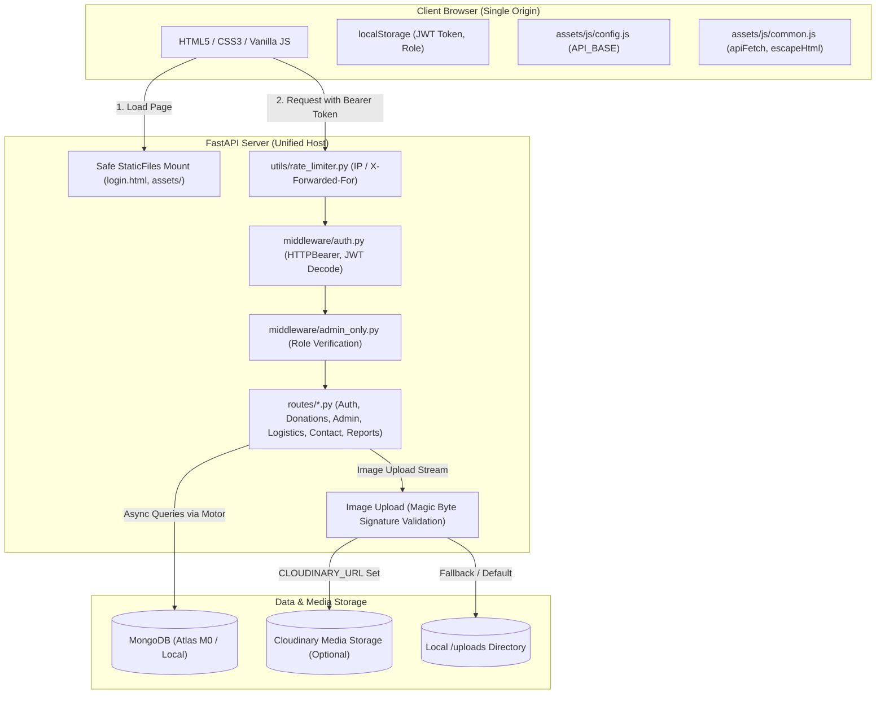
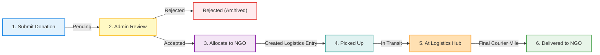

# Charity Flow

> An end-to-end donation and logistics management platform connecting generous donors with verified NGOs through an admin-moderated distribution pipeline.

---

## Live Demo

- **Hosted URL**: [https://charityflow.onrender.com](https://charityflow.onrender.com) *(Placeholder)*
- **Hosting Notice**: Deployed on Render's free tier and MongoDB Atlas M0. Free tier web services automatically spin down after 15 minutes of inactivity; initial cold start may take approximately 30–50 seconds to wake up.

---

## Demo Access Credentials

To explore the platform without creating a new account, use the pre-seeded demo donor credentials:

| Role | Email | Password | Access Scope |
| :--- | :--- | :--- | :--- |
| **Donor** | `donor@charityflow.org` | `Donor@1234` | Submit donations, track drop-offs, send messages |
| **Admin** | *(Shared on request)* | *(Shared on request)* | Inventory allocation, logistics dispatch, user moderation |

> [!NOTE]
> For security best practices, administrative credentials are restricted and provided upon evaluation request. You can also seed custom admin credentials during local setup using environment variables.

---

## Application Screenshots

Visual walkthrough captures are maintained in the [`/docs/screenshots`](file:///c:/Users/Ved/OneDrive/Desktop/BACKSTREET%20TECHRUSH%20CHARITY%20FLOW/docs/screenshots) directory:

1. **Login & Registration**: [`docs/screenshots/login.png`](docs/screenshots/login.png) — Clean split authentication portal with real-time field validation.
2. **Donation Submission**: [`docs/screenshots/donate.png`](docs/screenshots/donate.png) — Donor submission workflow with drag-and-drop file upload and client/server magic-byte verification.
3. **Donor Account Dashboard**: [`docs/screenshots/myaccount.png`](docs/screenshots/myaccount.png) — Real-time donation tracking cards, responsive status badges, and inquiry message replies.
4. **Admin Overview Dashboard**: [`docs/screenshots/admin-dashboard.png`](docs/screenshots/admin-dashboard.png) — Platform metrics, real-time counters, daily UTC action counters, and quick management links.
5. **Item Allocation & Inventory**: [`docs/screenshots/item-allocation.png`](docs/screenshots/item-allocation.png) — Interactive donation cards with review actions (accept/reject) and verified NGO assignment.
6. **Logistics Dispatch Tracker**: [`docs/screenshots/dropoff-tracking.png`](docs/screenshots/dropoff-tracking.png) — Multi-stage shipment tracking pipeline with active/completed filters and simulated delivery transitions.

---

## Feature Overview

### Donor Capabilities
- **Authentication**: Secure registration and login issuing signed JSON Web Tokens (JWT).
- **Item Donation**: Submit donation requests specifying item category, pickup location, and description.
- **Image Uploads**: Multi-file photo upload with real file signature (magic byte) detection and Cloudinary / local fallback storage.
- **Status Tracking**: Visual progress badges (`pending` → `accepted` → `allocated` → `at_hub` → `delivered`).
- **Personal History**: Filter between active shipments and completed donations.
- **Inquiry Messaging**: Integrated contact portal to communicate directly with platform administrators.

### Administrator Capabilities
- **Role-Based Access Control (RBAC)**: Enforced via JWT payload claims and server-side whitelist verification.
- **Real-Time Analytics**: Live aggregate statistics across pending items, active deliveries, delivered goods, and registered accounts.
- **Inventory Moderation**: Accept or reject pending donations with instant status updates.
- **NGO Allocation**: Route accepted items to verified partner NGOs with automatic logistics entry creation.
- **Logistics Dispatch**: Stage-by-stage tracking control (`allocated` → `picked_up` → `at_hub` → `delivered`) with delivery cancellation and hub revert features.
- **Automated Delivery Simulation**: Background task pipeline simulating real-world courier transport stages for demonstrations.
- **User & NGO Directory**: Inspect registered donor accounts, verified partner NGOs, and system roles.
- **Audit Logging**: Comprehensive UTC audit logs tracking all administrator actions and donations.
- **Inquiry Management**: Review contact submissions, toggle spam flags, and publish replies visible on donor dashboards.
- **Demo Data Reset**: One-click idempotent reset button restoring demo inventory without wiping registered users.

---

## Technology Stack

| Layer | Technologies |
| :--- | :--- |
| **Frontend** | Vanilla HTML5, CSS3 Modern Flexbox/Grid, Vanilla JavaScript (ES6+), FontAwesome 6, Google Fonts |
| **Backend API** | Python 3.11, FastAPI 0.104.1, Starlette, Uvicorn (ASGI) |
| **Database** | MongoDB (Local Community Server / MongoDB Atlas M0 Cloud) |
| **Async ODM/Driver** | Motor 3.3.2 (AsyncIO driver for MongoDB) |
| **Authentication** | OAuth2 Bearer Tokens (JWT), Python-Jose 3.3.0, Passlib 1.7.4 (Bcrypt 4.0.1) |
| **File Storage** | Cloudinary SDK 1.36.0 (Cloud hosting) / Static Mount (Local disk `/uploads`) |
| **Deployment** | Render Web Service (Single-URL unified frontend & API service) |

---

## System Architecture



---

## Donation Pipeline Flow



---

## Repository Structure

```
BACKSTREET TECHRUSH CHARITY FLOW/
│
├── .gitignore                   # Ignored files (venv, .env, uploads, __pycache__)
├── .python-version              # Python version pin for Render deployment (3.11.9)
├── render.yaml                  # Render Infrastructure-as-Code Blueprint (runs build from repo root)
├── README.md                    # Platform documentation (this file)
│
├── assets/                      # Static client assets
│   ├── js/
│   │   ├── config.js            # Environment API_BASE resolver
│   │   └── common.js            # Shared helpers (apiFetch, escapeHtml, auth, date formatting)
│   └── ...                      # Stylesheets, icons, client images
│
├── docs/
│   └── screenshots/
│       └── .gitkeep             # Screenshot placeholder directory
│
├── aboutus.html                 # About Charity Flow mission & values
├── admin.html                   # Admin overview dashboard
├── contactus.html               # Public contact & inquiry portal
├── donate.html                  # Donor donation submission form
├── dropoff-tracking.html        # Admin logistics tracking & stage transitions
├── frontend.html                # Donor home & platform services
├── item-allocation.html         # Admin inventory review & NGO assignment
├── login.html                   # Unified authentication portal (root entry `/`)
├── manage-users.html            # Admin directory of donors, NGOs & activity
├── myaccount.html               # Donor personal dashboard & inquiry replies
├── ourservices.html             # Platform service breakdown
├── reports-history.html         # Admin reports, spam moderation & inquiries
│
└── charityflow-backend/         # FastAPI backend service
    ├── .env.example             # Environment configuration template
    ├── main.py                  # Server entry point, router mounts, safe static file serving
    ├── config.py                # Environment configuration & strict startup validation
    ├── db_indexes.py            # MongoDB index definitions (unique emails, timestamps)
    ├── requirements.txt         # Pinned production Python dependencies
    ├── README.md                # Quick-reference backend documentation
    │
    ├── middleware/
    │   ├── auth.py              # JWT authentication & HTTPBearer token extraction
    │   └── admin_only.py        # RBAC dependency ensuring admin authorization
    │
    ├── models/                  # Pydantic data schemas
    │   ├── user.py              # User account model
    │   ├── donation.py          # Donation record model
    │   ├── logistics.py         # Logistics tracker model
    │   ├── ngo.py               # Partner NGO schema
    │   ├── contact.py           # Contact message schema
    │   └── activity_log.py      # System audit log schema
    │
    ├── routes/                  # Modular API endpoints
    │   ├── auth.py              # Registration & login
    │   ├── donations.py         # Item donation submission & status
    │   ├── admin.py             # Admin analytics & NGO allocation
    │   ├── logistics.py         # Dispatch updates & shipment management
    │   ├── contact.py           # Inquiries, admin replies & spam flags
    │   ├── reports.py           # Platform reports & activity timeline
    │   └── myaccount.py         # Donor personal history
    │
    ├── seed/                    # Database seeding scripts
    │   ├── seed_all.py          # Unified idempotent seeding runner
    │   ├── seed_users.py        # Default admin & donor accounts
    │   └── seed_ngos.py         # Verified demo NGOs
    │
    ├── tests/
    │   └── smoke_test.py        # 56-point automated integration test suite
    │
    └── utils/
        ├── rate_limiter.py      # In-memory sliding window rate limiter (proxy-aware)
        └── serializers.py       # MongoDB BSON & ISO-8601 date serialization helpers
```

---

## API Endpoints Reference

| Method | Endpoint | Required Role | Description |
| :--- | :--- | :--- | :--- |
| `GET` | `/` | Public | Serves `login.html` (single-origin frontend root) |
| `GET` | `/api` | Public | API root service welcome message |
| `GET` | `/health` | Public | MongoDB connection ping & server health status |
| `POST` | `/auth/register` | Public | Register new donor account (email format, 8+ char password) |
| `POST` | `/auth/login` | Public | Authenticate user credentials and issue signed JWT |
| `POST` | `/donate` | Donor / Admin | Submit donation with validated image files (max 5 MB, 5 files) |
| `GET` | `/donations` | Admin | Retrieve all platform donations |
| `GET` | `/donations/{id}` | Owner / Admin | Retrieve a specific donation by ObjectId (403 for other donors) |
| `PATCH` | `/donations/{id}/status` | Admin | Accept or reject a pending donation |
| `GET` | `/donations/my-donations` | Donor / Admin | Retrieve active donations for the authenticated user |
| `GET` | `/donations/my-history` | Donor / Admin | Retrieve completed/historical donations for the authenticated user |
| `GET` | `/admin/stats` | Admin | Aggregate dashboard counters (pending, active, delivered, users) |
| `GET` | `/admin/actions-today` | Admin | Count of administrative actions performed today in UTC |
| `GET` | `/admin/users` | Admin | Directory listing of registered accounts |
| `GET` | `/admin/ngos` | Admin | Directory listing of verified partner NGOs |
| `POST` | `/admin/allocate` | Admin | Allocate an accepted donation to an NGO & create shipment |
| `GET` | `/admin/my-activity` | Admin | Personal audit log entries for the current administrator |
| `GET` | `/admin/all-activity` | Admin | Platform-wide administrator audit log |
| `POST` | `/admin/reset-test-data` | Admin | Restore demo inventory and shipments to clean initial state |
| `GET` | `/logistics` | Admin | Retrieve all active and completed shipment entries |
| `PATCH` | `/logistics/{id}` | Admin | Advance shipment status (`picked_up` → `at_hub` → `delivered`) |
| `PATCH` | `/logistics/{id}/cancel-delivery` | Admin | Revert a delivered shipment back to active transit |
| `POST` | `/contact` | Public | Submit contact inquiry or feedback |
| `GET` | `/contact/my-messages` | Donor / Admin | Retrieve inquiries sent by the authenticated user with admin replies |
| `POST` | `/contact/{id}/reply` | Admin | Submit administrator reply to an inquiry message |
| `PATCH` | `/contact/{id}/flag` | Admin | Toggle spam / flagged status on an inquiry |
| `GET` | `/reports/activity` | Admin | Timeline feed of donations, allocations, and deliveries |
| `GET` | `/reports/spam` | Admin | Filtered list of flagged contact inquiries |
| `GET` | `/reports/contact` | Admin | Full list of contact submissions for moderation |
| `GET` | `/uploads/{filename}` | Public | Serve locally stored donation images |
| `GET` | `/docs` | Public | Interactive Swagger OpenAPI documentation |
| `GET` | `/openapi.json` | Public | OpenAPI 3.0 JSON specification schema |

---

## MongoDB Collections & Schema

### 1. `users`
| Field | Type | Description |
| :--- | :--- | :--- |
| `_id` | `ObjectId` | Unique document identifier |
| `name` | `string` | User's full name |
| `email` | `string` | Unique email address (lowercased & stripped, unique index) |
| `password_hash` | `string` | Salted Bcrypt password hash |
| `role` | `string` | Access tier: `"donor"` or `"admin"` |
| `created_at` | `ISODate` | Account creation timestamp (indexed) |

### 2. `donations`
| Field | Type | Description |
| :--- | :--- | :--- |
| `_id` | `ObjectId` | Unique donation identifier |
| `donor_email` | `string` | Owner email matching authenticated user (indexed) |
| `category` | `string` | Item category (e.g. `"Clothes"`, `"Food"`, `"Books"`) |
| `location` | `string` | Donor pickup city or address |
| `description` | `string` | Detailed item description |
| `photos` | `array[string]` | Relative paths (`uploads/...`) or Cloudinary HTTPS URLs |
| `status` | `string` | `"pending"`, `"accepted"`, `"rejected"`, `"allocated"`, `"delivered"` |
| `created_at` | `ISODate` | Submission timestamp (indexed) |

### 3. `logistics`
| Field | Type | Description |
| :--- | :--- | :--- |
| `_id` | `ObjectId` | Unique logistics identifier |
| `donation_id` | `string` | Stringified ObjectId of linked donation (unique index) |
| `donor_email` | `string` | Associated donor email |
| `target_ngo` | `string` | Assigned NGO contact email |
| `ngo_name` | `string` | Human-readable name of the receiving organization |
| `stage` | `string` | Shipment phase: `"allocated"`, `"picked_up"`, `"at_hub"`, `"delivered"` |
| `status` | `string` | Shipment status: `"active"` or `"completed"` |
| `created_at` | `ISODate` | Initial dispatch creation timestamp |
| `updated_at` | `ISODate` | Last stage advancement timestamp (indexed) |

### 4. `ngos`
| Field | Type | Description |
| :--- | :--- | :--- |
| `_id` | `ObjectId` | Unique NGO identifier |
| `name` | `string` | Registered organization title |
| `email` | `string` | Primary contact email (unique index) |
| `phone` | `string` | Operational telephone contact |
| `address` | `string` | Physical center address |
| `city` | `string` | Operational city |
| `category` | `string` | Specialization focus (e.g., `"Child Welfare"`, `"Disaster Relief"`) |
| `status` | `string` | Verification state (`"verified"`) |
| `created_at` | `ISODate` | Partner onboarding timestamp |

### 5. `contact_messages`
| Field | Type | Description |
| :--- | :--- | :--- |
| `_id` | `ObjectId` | Unique inquiry identifier |
| `name` | `string` | Sender name |
| `email` | `string` | Sender email (indexed) |
| `message` | `string` | Inquiry message body |
| `reply` | `string \| null` | Administrator response text |
| `replied_at` | `ISODate \| null` | Timestamp when administrator responded |
| `replied_by` | `string \| null` | Email of replying administrator |
| `status` | `string` | `"pending"` or `"replied"` |
| `flagged` | `boolean` | Spam/moderation flag (`true` / `false`, indexed) |
| `created_at` | `ISODate` | Submission timestamp (indexed) |

### 6. `activity_logs`
| Field | Type | Description |
| :--- | :--- | :--- |
| `_id` | `ObjectId` | Unique audit log identifier |
| `user_email` | `string` | Actor email initiating the action |
| `action` | `string` | Action key (e.g. `"donation"`, `"allocation"`, `"logistics_update"`) |
| `details` | `string` | Human-readable audit narrative |
| `created_at` | `ISODate` | Event timestamp in UTC (indexed) |

---

## Security Implementation

- **Strict Startup Validation**: The application refuses to boot if `JWT_SECRET` or `MONGO_URI` is absent. No hardcoded or silent fallbacks exist.
- **Fail-Safe JWT Bearer Middleware**: Missing or malformed tokens return strict `401 Unauthorized` with `WWW-Authenticate: Bearer` headers. Explicit error details differentiate between `"Token expired"` and `"Invalid token"`.
- **Granular RBAC**: All administrative routes (`/admin/*`, `/logistics/*`, `/reports/*`) enforce an explicit `admin_only` dependency that verifies the role claim and cross-checks the server-side `ADMIN_EMAILS` whitelist. Logged-in non-admins receive `403 Forbidden`.
- **Stored XSS Prevention**: All dynamic innerHTML rendering passes through an HTML escaping function (`escapeHtml`) preventing script injection via user names, messages, replies, descriptions, or NGO titles.
- **Image Magic-Byte Verification**: Uploaded images are checked at the binary level for true magic bytes (`FF D8 FF` for JPEG, `89 50 4E 47` for PNG, `RIFF...WEBP` for WEBP). Spoofed file extensions or disguised executables are rejected with `400 Bad Request`.
- **Upload File Limits**: Strictly enforced limits of maximum 5 files per donation and maximum 5 MB per individual file. Uploaded files are assigned random UUID filenames to prevent path traversal attacks.
- **Proxy-Aware Sliding Window Rate Limiting**: In-memory rate limiting applied to sensitive endpoints (`/auth/login`, `/auth/register`, `/contact`). When `TRUST_PROXY=true`, client IP extraction reads the first IP of `X-Forwarded-For`; when `false`, it falls back to `request.client.host` to prevent header spoofing in local development.
- **CORS Protection**: Controlled via `CORS_ORIGINS`. When restricted to production domains, credentials are explicitly allowed; when set to `*` for local development, `allow_credentials` is disabled.
- **Input Validation**: Pydantic models validate email RFC compliance and enforce minimum 8-character passwords with automatic whitespace trimming and lowercasing.

---

## Local Setup Guide (Windows)

### Prerequisites
- Python 3.11 or 3.12 installed ([python.org](https://www.python.org/))
- Git installed ([git-scm.com](https://git-scm.com/))
- Local MongoDB Community Server running on `localhost:27017` OR a free MongoDB Atlas connection URI

### Step-by-Step Instructions

1. **Clone the Repository**:
   ```powershell
   git clone https://github.com/YOUR-USER/charity-flow.git
   cd "charity-flow"
   ```

2. **Create & Activate Virtual Environment**:
   ```powershell
   cd charityflow-backend
   python -m venv venv
   .\venv\Scripts\activate
   ```
   *(If script execution is disabled, run: `Set-ExecutionPolicy -ExecutionPolicy RemoteSigned -Scope CurrentUser`)*

3. **Install Dependencies**:
   ```powershell
   pip install -r requirements.txt
   ```

4. **Configure Environment Variables**:
   Copy `.env.example` to `.env`:
   ```powershell
   copy .env.example .env
   ```
   Open `.env` in a text editor and provide your secrets:
   ```ini
   MONGO_URI=mongodb://localhost:27017/charityflow
   JWT_SECRET=your_super_secret_jwt_key_at_least_32_characters_long
   ADMIN_EMAILS=admin@charityflow.org
   PORT=8000
   DEMO_MODE=true
   TRUST_PROXY=false
   ```

5. **Seed the Database (One-Command Seeding)**:
   Ensure your MongoDB instance is running, then seed initial users and partner NGOs:
   ```powershell
   python -m seed.seed_all
   ```
   *(Output will confirm pre-seeded admin and donor accounts alongside verified NGOs).*

6. **Start the Application**:
   ```powershell
   uvicorn main:app --reload --port 8000
   ```
   *(If port 8000 is occupied by Docker Desktop or another service, use `--port 8001`).*

7. **Access the Application**:
   Open your browser and navigate to:
   ```
   http://localhost:8000/
   ```
   The root path automatically serves `login.html`.

---

## Testing API Endpoints

### 1. Interactive Swagger UI (`/docs`)
1. Open [http://localhost:8000/docs](http://localhost:8000/docs) in your browser.
2. Expand the `POST /auth/login` endpoint, click **Try it out**, and submit:
   ```json
   {
     "email": "donor@charityflow.org",
     "password": "Donor@1234"
   }
   ```
3. Copy the returned `token` string from the JSON response (without quotes).
4. Scroll to the top of `/docs` and click the green **Authorize** button.
5. In the `Value` box, paste the token and click **Authorize**, then **Close**.
6. All protected routes (e.g. `POST /donate`, `GET /donations/my-donations`) will now include your Bearer token automatically!

### 2. Postman
1. Create a request to `POST http://localhost:8000/auth/login`.
2. In the **Body** tab (JSON), send `{ "email": "donor@charityflow.org", "password": "Donor@1234" }` (or your authenticated admin credentials).
3. Copy the `token` from the response.
4. For protected endpoints (such as `GET http://localhost:8000/donations/my-donations`), go to the **Authorization** tab.
5. Select **Type: Bearer Token** and paste the token in the **Token** field.

### 3. Automated Smoke Test Suite
Run the 56-point automated smoke test against your running server:
```powershell
cd charityflow-backend
python tests/smoke_test.py http://127.0.0.1:8000
```
The suite verifies health checks, root routes, 401 unauthenticated enforcement, 403 donor isolation on admin paths, photo upload signature checks, logistics progression, and contact reply tracking.

---

## Cloud Deployment Guide

### Step 1: MongoDB Atlas Free Cluster (M0)
1. Sign up for a free account at [mongodb.com/atlas](https://www.mongodb.com/atlas).
2. Create a free **M0 Sandbox** cluster in your preferred cloud region.
3. Under **Database Access**, create a database user with password authentication.
4. Under **Network Access**, add `0.0.0.0/0` (Allow access from anywhere) to accept connections from Render.
5. Click **Connect** → **Drivers** → Copy the SRV connection URI:
   ```
   mongodb+srv://<username>:<password>@cluster0.abcde.mongodb.net/charityflow?retryWrites=true&w=majority
   ```
6. **Remote Database Seeding**: You can seed your remote Atlas database directly from your local terminal before deploying:
   ```powershell
   $env:MONGO_URI="mongodb+srv://<username>:<password>@cluster0.abcde.mongodb.net/charityflow?retryWrites=true&w=majority"
   python -m seed.seed_all
   ```

### Step 2: Render Web Service Deployment
1. Sign in to [render.com](https://render.com) and link your GitHub repository.
2. Click **New +** → **Blueprint** → Select your `charity-flow` repository.
3. Render automatically reads `render.yaml` at the repository root with the following configuration:
   - **Environment**: Python 3.11 (`.python-version` at repository root)
   - **Build Command**: `pip install -r charityflow-backend/requirements.txt`
   - **Start Command**: `cd charityflow-backend && uvicorn main:app --host 0.0.0.0 --port $PORT`
   - **Health Check Path**: `/health`
4. Set the required Secret Environment Variables in the Render dashboard:
   - `JWT_SECRET`: Generate a secure 64-character random string (`openssl rand -hex 32`)
   - `MONGO_URI`: Your MongoDB Atlas connection URI
   - `ADMIN_EMAILS`: `admin@charityflow.org` (or your chosen admin emails)
   - `SEED_ADMIN_PASSWORD`: A secure custom password for the pre-seeded admin account
   - `SEED_DONOR_PASSWORD`: A secure password for the demo donor account
   - `TRUST_PROXY`: `true`
   - `DEMO_MODE`: `true`
   - `CORS_ORIGINS`: `*` (or your Render URL `https://your-service.onrender.com`)
   - `CLOUDINARY_URL`: *(Optional)* `cloudinary://<api_key>:<api_secret>@<cloud_name>`

---

## Key Design Decisions

1. **Unified Single-Origin Deployment**:
   Rather than managing two separate hosting providers (or dealing with cross-origin preflight latency and cookie/token synchronization), FastAPI serves both the REST API and the frontend assets from a single domain. `SafeFrontendStaticFiles` is mounted strictly after all API routers, `/uploads`, and `/health`, ensuring that API endpoints always take priority while cleanly serving HTML pages and preventing access to server source code or environment files.

2. **Route Order Precedence**:
   API routers (`auth`, `donations`, `admin`, `logistics`, `contact`, `reports`) and `/uploads` are registered before the static catch-all mount. Explicit route declarations ensure Swagger documentation (`/docs`, `/openapi.json`) and system health probes are never intercepted by frontend routers.

3. **Safe ObjectId & DateTime Serialization**:
   FastAPI and Pydantic v2 do not natively serialize MongoDB BSON `ObjectId` or raw datetime objects. The platform employs a centralized serialization helper (`utils/serializers.py`) that recursively converts `ObjectId` to strings and datetime instances to standard ISO-8601 strings, preventing JSON serialization crashes.

4. **Security-First Magic-Byte Upload Verification**:
   Relying solely on user-provided MIME types or file extensions allows attackers to disguise executable scripts as images. The donation pipeline reads initial file bytes and validates against authentic binary signatures (JPEG, PNG, WEBP), discarding untrusted files with clear status codes before disk or cloud persistence.

5. **Demo Delivery Simulation**:
   For exhibition and hackathon judging, real-world deliveries cannot take days. The platform integrates an asynchronous background delivery simulation mode (`DEMO_MODE=true`) that automatically progresses accepted items through transit checkpoints every 90 seconds while permitting manual administrator intervention at any time.

---

## Known Limitations & Future Roadmap

- **Push / Email Notifications**: Automated emails (via SendGrid or AWS SES) to alert donors when items are accepted or delivered.
- **Self-Service NGO Registration**: Multi-tier verification pipeline allowing new charities to submit registration credentials and tax-exemption documents.
- **Monetary Donations (Stripe / Razorpay)**: Integrate payment gateway processing for financial contributions alongside physical goods.
- **Cursor-Based Pagination**: Introduce infinite scrolling and cursor pagination for platforms scaling past 10,000+ active donations.
- **Refresh Token Rotation**: Extend JWT security with short-lived access tokens (15 minutes) and HTTP-only cookie refresh tokens.

---

## License & Credits

- **Hackathon Project**: Built with passion by the Charity Flow Engineering Team.
- **License**: MIT License — open source and free for educational and charitable community use.

